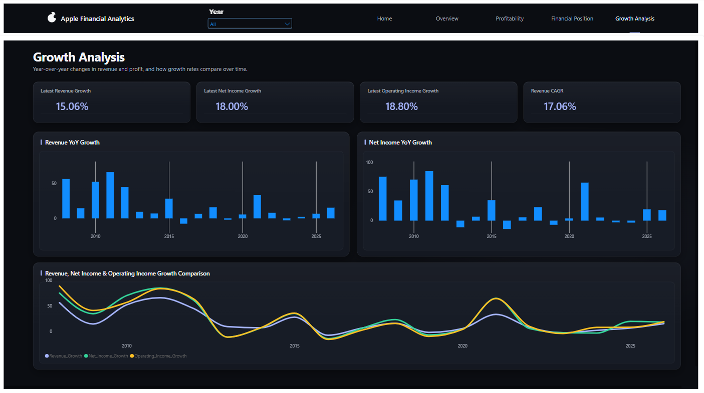

# Apple Financial BI & Analytics

An end-to-end **Financial Business Intelligence and Data Engineering**
project that transforms Apple's historical financial data from the SEC
EDGAR Company Facts API into structured, analytics-ready datasets and
business insights.

The project brings together a **Bronze--Silver--Gold architecture**,
Python-based ETL, MySQL database integration, SQL financial analysis,
and a Power BI reporting layer.

> **Project focus:** Financial Analytics & Business Intelligence,
> supported by an end-to-end Data Engineering workflow.

------------------------------------------------------------------------

## Table of Contents

-   [Business Problem & Objectives](#business-problem--objectives)
-   [Project Architecture](#project-architecture)
-   [Data Source](#data-source)
-   [What I Built](#what-i-built)
-   [Database & Analytics Layer](#database--analytics-layer)
-   [Key Results](#key-results)
-   [Business Insights](#business-insights)
-   [Power BI Dashboard](#power-bi-dashboard)
-   [Technology Stack](#technology-stack)
-   [Repository Structure](#repository-structure)
-   [Limitations & Notes](#limitations--notes)

------------------------------------------------------------------------

## Business Problem & Objectives

Financial data is useful only when it can be collected, prepared,
organized, analyzed, and presented in a way that supports business
understanding.

The objective of this project is to build a repeatable data workflow for
analyzing Apple's annual financial performance and answering questions
such as:

-   How has Apple's revenue changed over time?
-   How quickly have revenue and earnings grown?
-   How efficiently does the company convert revenue into profit?
-   How has the company's financial position changed?
-   What important trends and exceptions can be identified from the
    financial results?

------------------------------------------------------------------------

## Project Architecture

The solution follows this end-to-end flow:

``` text
SEC EDGAR – Company Facts API
              |
              v
      Python Data Extraction
              |
              v
       BRONZE – Raw Data
       Original API JSON
              |
              v
   SILVER – Cleaned Data
 Parse, standardize, validate,
 handle duplicates and missing data
              |
              v
    GOLD – Curated Data
 Annual financial records ready
       for analysis and BI
              |
              v
       MySQL Database
       apple_financials
              |
              v
        SQL Analytics
 Revenue | Profitability | Financial
 Position | Growth | Business Insights
              |
              v
          SQL Views
              |
              v
          Power BI
     Financial BI Reporting
```

### Medallion Architecture

#### 1. Bronze Layer -- Raw

-   Connected to the SEC Company Facts API.
-   Extracted Apple's financial facts in JSON format.
-   Preserved the source response as raw input for downstream
    processing.
-   Kept raw ingestion separate from data transformation.

#### 2. Silver Layer -- Cleaned & Standardized

-   Parsed the semi-structured JSON response.
-   Selected the financial concepts required for the analysis.
-   Organized annual financial records by fiscal year.
-   Worked with alternative revenue concepts, including:
    -   `SalesRevenueNet`
    -   `RevenueFromContractWithCustomerExcludingAssessedTax`
-   Cleaned and structured the records using Python and Pandas.
-   Handled duplicate records and performed data-quality checks.
-   Preserved missing values rather than replacing them with unsupported
    values.

#### 3. Gold Layer -- Analytics-Ready

Prepared curated annual financial records for downstream SQL analysis
and BI reporting.

The financial dataset includes:

-   Revenue
-   Net Income
-   Operating Income
-   Total Assets
-   Total Liabilities

The Gold layer provides a business-oriented structure that makes the
financial measures easier to query, analyze, and report.

------------------------------------------------------------------------

## Data Source

  Item              Details
  ----------------- --------------------------------
  Source            SEC EDGAR -- Company Facts API
  Company           Apple Inc.
  Ticker            AAPL
  CIK               `0000320193`
  Source format     JSON
  Analysis period   FY2007--FY2026

The project uses company financial facts published through the SEC API
as its source data.

------------------------------------------------------------------------

## What I Built

### 1. Python ETL Pipeline

I implemented an ETL workflow using Python.

**Extract** - Sent requests to the SEC Company Facts API. - Retrieved
Apple's financial facts in JSON format.

**Transform** - Parsed the API response. - Selected the required
financial concepts. - Organized annual records by fiscal year. - Used
Pandas to clean and structure the data. - Applied duplicate handling and
data-quality checks. - Prepared the curated annual dataset.

**Load** - Connected the Python workflow to MySQL. - Loaded the annual
financial records into the database. - Used an Upsert approach to avoid
creating duplicate records when loading existing fiscal-year records
again.

### 2. Database Integration

  Item              Implementation
  ----------------- -------------------------
  Database engine   MySQL
  Database          `apple_financials`
  Main table        `annual_financials`
  Data grain        Annual financial record
  Loading method    Upsert

The database stores the prepared financial data and provides the source
for SQL-based analysis.

### 3. SQL Financial Analytics

I organized the analysis into focused SQL modules:

  -----------------------------------------------------------------------
  SQL Module                          Analysis
  ----------------------------------- -----------------------------------
  `01_revenue_analysis.sql`           Revenue trends and growth

  `02_profitability_analysis.sql`     Net income, operating income, and
                                      margins

  `03_financial_position.sql`         Assets, liabilities, and equity
                                      indicators

  `04_growth_analysis.sql`            Year-over-year financial growth

  `05_business_insights.sql`          Business-oriented findings

  `06_create_views.sql`               Reusable analytical SQL views
  -----------------------------------------------------------------------

### 4. SQL Views

The analytics layer includes the following views:

-   `vw_revenue_analysis`
-   `vw_profitability_analysis`
-   `vw_financial_position`
-   `vw_growth_analysis`

These views provide reusable analytical outputs for reporting.

------------------------------------------------------------------------

## Key Results

The following results come from the SQL analysis outputs supplied for
FY2007--FY2026. Monetary values are in **USD billions**, unless stated
otherwise.

### Revenue

  Metric                                         Result
  ---------------------------------- ------------------
  FY2007 Revenue                               \$24.01B
  FY2026 Revenue                              \$478.83B
  Revenue CAGR (FY2007--FY2026)                  17.06%
  Revenue multiple over the period               19.94x
  Highest annual revenue growth        65.96% in FY2011
  FY2026 Revenue YoY Growth                      15.06%

### Profitability

  Metric                  FY2025      FY2026   FY2026 YoY Growth
  ------------------ ----------- ----------- -------------------
  Revenue              \$416.16B   \$478.83B              15.06%
  Net Income           \$112.01B   \$132.18B              18.00%
  Operating Income     \$133.05B   \$158.06B              18.80%

  Margin Metric               FY2026   Period Average
  ------------------------- -------- ----------------
  Net Profit Margin           27.60%           22.51%
  Operating Profit Margin     33.01%           28.34%

### Financial Position

  FY2026 Metric                      Result
  ----------------------------- -----------
  Total Assets                    \$404.55B
  Total Liabilities               \$292.46B
  Total Equity                    \$112.09B
  Liabilities-to-Assets Ratio        72.29%
  Equity Ratio                       27.71%

The Liabilities-to-Assets ratio declined from **85.64% in FY2022** to
**72.29% in FY2026**, a decrease of **13.35 percentage points**.

Total Equity increased from **\$50.67B in FY2022** to **\$112.09B in
FY2026**.

### FY2026 Growth Snapshot

  Metric                FY2026 YoY Growth
  ------------------- -------------------
  Revenue                          15.06%
  Net Income                       18.00%
  Operating Income                 18.80%
  Total Assets                     12.61%
  Total Liabilities                 2.43%

------------------------------------------------------------------------

## Business Insights

The SQL analysis produced the following business findings.

### 1. Long-Term Revenue Expansion

Apple's revenue increased from **\$24.01B in FY2007** to **\$478.83B in
FY2026**, reaching approximately **19.94 times** its FY2007 level. The
calculated Revenue CAGR was **17.06%** over 19 annual intervals.

**Business meaning:** The supplied results show substantial long-term
revenue expansion, although the annual growth rate was not constant.

### 2. FY2011 Had the Highest Annual Revenue Growth

The highest Revenue YoY Growth in the supplied dataset was **65.96% in
FY2011**.

**Business meaning:** FY2011 was the strongest year by revenue growth
rate; it was not the year with the highest revenue value.

### 3. Revenue Growth Was Not Positive Every Year

Revenue declined in:

  Fiscal Year     Revenue YoY Growth
  ------------- --------------------
  FY2016                      -7.73%
  FY2019                      -2.04%
  FY2023                      -2.80%

Revenue growth returned to positive territory in FY2024 (**2.02%**),
FY2025 (**6.43%**), and FY2026 (**15.06%**).

**Business meaning:** The long-term direction was upward, but the
company experienced temporary annual contractions before returning to
growth.

### 4. FY2026 Was a Strong Profitability Year

In FY2026: - Net Income grew by **18.00%**. - Operating Income grew by
**18.80%**. - Revenue grew by **15.06%**.

Both earnings measures grew faster than revenue.

**Business meaning:** Earnings growth outpaced sales growth in FY2026,
alongside higher reported profit margins.

### 5. FY2026 Had the Highest Net Profit Margin in the Supplied Results

Net Profit Margin reached **27.60%** in FY2026, compared with the
supplied period average of **22.51%**.

Operating Profit Margin reached **33.01%**, compared with the supplied
period average of **28.34%**.

**Business meaning:** Both reported margins were above their respective
historical averages in FY2026.

### 6. The Liabilities-to-Assets Ratio Improved Compared with FY2022

The ratio moved from **85.64% in FY2022** to **72.29% in FY2026**.

**Business meaning:** Liabilities represented a smaller share of assets
in FY2026 than at the FY2022 peak. This describes a change in capital
structure; it does not by itself prove stronger liquidity or lower
financial risk.

### 7. Total Equity Recovered After FY2022

Total Equity increased from **\$50.67B in FY2022** to **\$112.09B in
FY2026**.

**Business meaning:** The supplied figures show a substantial recovery
in total equity from its FY2022 low.

### 8. FY2026 Showed Broad-Based Growth

Revenue, Net Income, Operating Income, and Total Assets increased in
FY2026. Total Liabilities also increased, but at a slower rate than
Total Assets.

**Business meaning:** The latest year in the supplied results showed
growth across several financial measures, with earnings growing faster
than revenue.

------------------------------------------------------------------------

## Executive Conclusion

Across FY2007--FY2026, Apple's supplied financial results show
substantial long-term revenue expansion, with a Revenue CAGR of
**17.06%**. FY2026 recorded the highest revenue in the dataset and the
highest Net Profit Margin in the supplied results. Net Income and
Operating Income grew faster than Revenue in FY2026, while both net and
operating profit margins were above their respective period averages.

The financial-position indicators also changed compared with FY2022: the
Liabilities-to-Assets ratio declined, and Total Equity increased from
its FY2022 low. At the same time, the historical declines in revenue and
earnings show why performance should be monitored across multiple years
rather than judged from a single year.

------------------------------------------------------------------------

## Power BI Dashboard

This section is reserved for screenshots of the Power BI report. Add
your actual dashboard screenshots to the repository (for example, inside
`images/`) and update the image paths below.

### 1. Executive Overview

A high-level view of the main financial KPIs and long-term performance.


### 2. Revenue Analysis

Revenue trends, annual changes, and long-term growth.


### 3. Profitability Analysis

Net Income, Operating Income, and profit margin performance.


### 4. Financial Position

Assets, liabilities, equity, and capital-structure indicators.


### 5. Growth Analysis

Year-over-year growth across key financial measures.



> Replace the placeholder image files and paths with your real Power BI
> screenshots. Remove any dashboard section that has not been
> implemented.

------------------------------------------------------------------------

## Technology Stack

  Technology               Role
  ------------------------ -------------------------------------
  SEC Company Facts API    Financial data source
  Python                   ETL pipeline development
  Requests                 API communication
  Pandas                   Data transformation and cleaning
  JSON                     Raw source-data format
  CSV                      Structured data exchange
  Bronze / Silver / Gold   Layered data architecture
  MySQL                    Relational database storage
  SQL                      Financial analysis and views
  Power BI                 Business intelligence reporting
  Git & GitHub             Version control and project hosting

------------------------------------------------------------------------

## Repository Structure

The structure below is a suggested layout. Adjust it to match the actual
folders and files in this repository.

``` text
Apple-Financial-BI-Analytics/
│
├── data/
│   ├── raw/
│   └── processed/
│
├── scripts/
│   ├── extract/
│   ├── transform/
│   └── load/
│
├── sql/
│   ├── 01_revenue_analysis.sql
│   ├── 02_profitability_analysis.sql
│   ├── 03_financial_position.sql
│   ├── 04_growth_analysis.sql
│   ├── 05_business_insights.sql
│   └── 06_create_views.sql
│
├── images/
│   ├── dashboard-overview.png
│   ├── dashboard-revenue.png
│   ├── dashboard-profitability.png
│   ├── dashboard-financial-position.png
│   └── dashboard-growth.png
│
├── powerbi/
│
├── README.md
├── requirements.txt
├── .env.example
└── .gitignore
```

------------------------------------------------------------------------

## Limitations & Notes

-   Findings describe the annual values and SQL outputs supplied for
    this project; they do not establish the causes behind changes in
    financial performance.
-   FY2007 Total Assets and Total Liabilities are missing in the
    supplied results. These values should remain missing and must not be
    interpreted as zero.
-   FY2007 to FY2026 contains 19 annual intervals for the reported
    Revenue CAGR calculation.
-   A lower Liabilities-to-Assets ratio does not independently establish
    stronger liquidity, lower borrowing costs, or lower financial risk.
-   A deeper liquidity and debt-servicing assessment would require
    additional indicators such as current assets, current liabilities,
    cash flow, and debt-related measures, which are not included in the
    supplied SQL results.
-   The Power BI screenshots in this README are placeholders until
    replaced with actual report images.
-   Keep credentials and secret values out of GitHub. Commit
    `.env.example` with placeholders and keep the real `.env` file
    private.

------------------------------------------------------------------------

## Project Summary

This project demonstrates how financial data can move from a public API
through a layered data pipeline into a relational database, then into
SQL analytics and business intelligence reporting.

It combines **Financial Analytics, Business Intelligence, Python ETL,
Medallion Architecture, MySQL, and SQL** in one end-to-end project.
