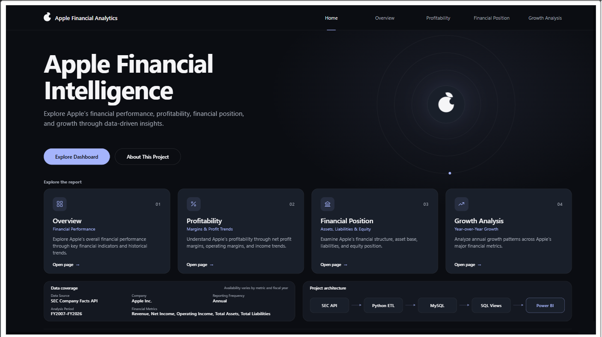
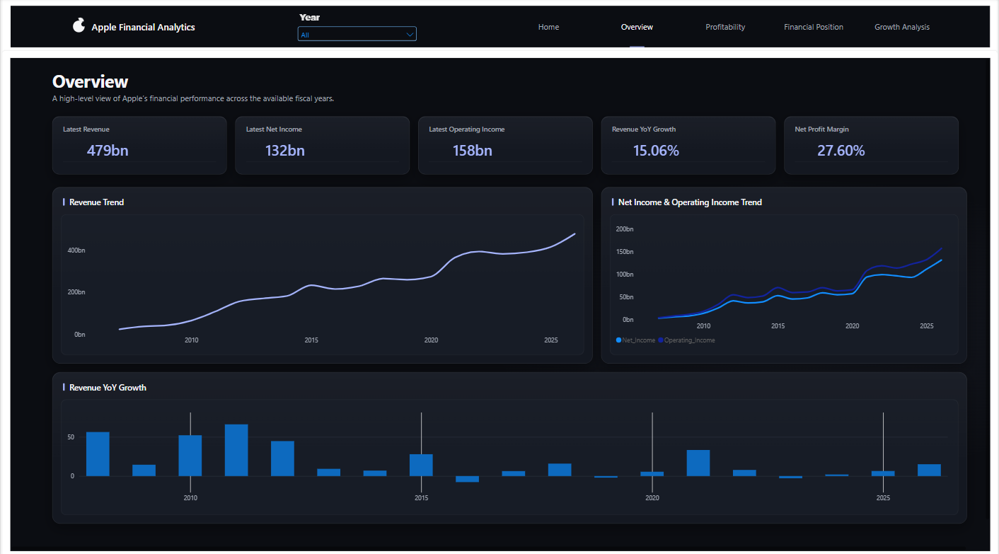
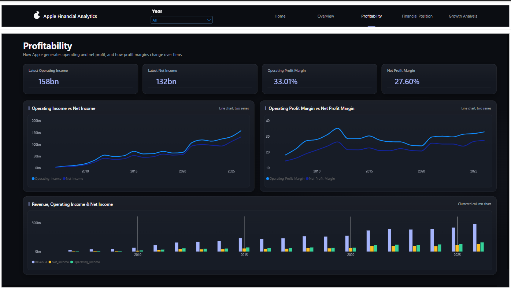
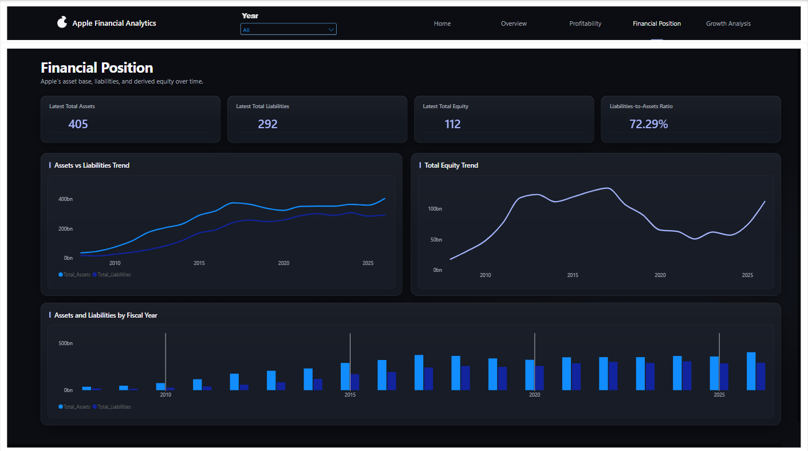
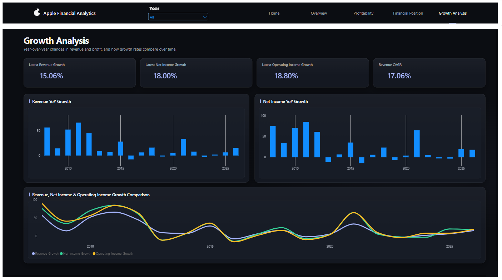

<div align="center">

#  Apple Financial BI & Analytics

### From SEC financial data to clear business insights

<p>
  
  
  
</p>

**An end-to-end project combining Python ETL, Medallion Architecture, MySQL, SQL Analytics, and Power BI.**

</div>

---

## 📌 Project at a Glance

This project takes Apple's historical financial data from the **SEC EDGAR Company Facts API**, processes it through a **Bronze → Silver → Gold** data pipeline, stores the prepared data in MySQL, and analyzes it using SQL.

The goal is simple: turn raw financial facts into organized information that helps explain Apple's revenue, profitability, growth, and financial position.

| Project detail | Description |
|---|---|
| 🏢 Company | Apple Inc. |
| 📊 Ticker | AAPL |
| 🗓️ Analysis period | FY2007–FY2026 |
| 🌐 Data source | SEC EDGAR – Company Facts API |
| 🧱 Architecture | Bronze / Silver / Gold |
| 🐍 ETL | Python, Requests, Pandas |
| 🗄️ Database | MySQL |
| 📈 Analytics & reporting | SQL, Power BI |

---

## 🧭 Table of Contents

- [🎯 Business Problem](#-business-problem)
- [🏗️ Architecture](#️-architecture)
- [🔄 What I Built](#-what-i-built)
- [📊 Key Results](#-key-results)
- [💡 Business Insights — Explained Simply](#-business-insights--explained-simply)
- [📈 Power BI Report](#-power-bi-report)
- [🛠️ Technology Stack](#️-technology-stack)
- [📁 Repository Structure](#-repository-structure)
- [⚠️ Notes & Limitations](#️-notes--limitations)

---
---

## 🎯 Business Problem

Financial data can be difficult to understand when it is available only as raw API responses or disconnected records.

I built this project to create a repeatable workflow that answers practical questions:

- How has Apple's revenue changed over time?
- Is the company generating more profit as revenue grows?
- How have assets, liabilities, and equity changed?
- Which years had a decline or a strong increase?
- What do the financial indicators tell us about the company's performance?

## 🏗️ Architecture

The project follows a layered data workflow:

```text
 SEC EDGAR – Company Facts API
              │
              ▼
       Python Extraction
              │
              ▼
       🥉 BRONZE LAYER
       Raw API JSON response
              │
              ▼
       🥈 SILVER LAYER
       Parsed • Cleaned • Validated
       Standardized annual records
              │
              ▼
       🥇 GOLD LAYER
       Analytics-ready financial data
              │
              ▼
         MySQL Database
         apple_financials
              │
              ▼
          SQL Analytics
              │
              ▼
           SQL Views
              │
              ▼
            Power BI
       Financial reporting
```

### 🥉 Bronze — Raw Data

- Retrieved Apple's financial facts from the SEC Company Facts API.
- Kept the original response in JSON format.
- Preserved the raw source before transformation.

### 🥈 Silver — Cleaned & Standardized Data

- Parsed the semi-structured JSON response.
- Selected the financial concepts needed for the analysis.
- Organized annual records by fiscal year.
- Worked with revenue concepts including `SalesRevenueNet` and `RevenueFromContractWithCustomerExcludingAssessedTax`.
- Used Python and Pandas to clean and structure the data.
- Handled duplicate records and performed data-quality checks.
- Preserved missing values instead of treating them as zero.

### 🥇 Gold — Analytics-Ready Data

Prepared annual financial records for SQL analysis and BI reporting, including:

- Revenue
- Net Income
- Operating Income
- Total Assets
- Total Liabilities

---

## 🔄 What I Built

### 1. 🐍 Python ETL Pipeline

| Step | What happens |
|---|---|
| **Extract** | Send requests to the SEC API and retrieve Apple's financial facts as JSON. |
| **Transform** | Parse the response, select required concepts, organize fiscal years, clean records, handle duplicates, and run quality checks. |
| **Load** | Load the prepared annual records into MySQL using an Upsert approach. |

**Why Upsert?** It allows existing fiscal-year records to be updated instead of inserting duplicate records every time the pipeline runs.

### 2. 🗄️ MySQL Database

| Item | Implementation |
|---|---|
| Database | `apple_financials` |
| Main table | `annual_financials` |
| Data grain | One annual financial record |
| Loading method | Upsert |

### 3. 🔎 SQL Financial Analytics

I separated the analysis into focused SQL modules:

| SQL file | What it analyzes |
|---|---|
| `01_revenue_analysis.sql` | Revenue trends and growth |
| `02_profitability_analysis.sql` | Net income, operating income, and margins |
| `03_financial_position.sql` | Assets, liabilities, and equity |
| `04_growth_analysis.sql` | Year-over-year growth |
| `05_business_insights.sql` | Business-oriented findings |
| `06_create_views.sql` | Reusable analytical views |

**SQL Views created:**

- `vw_revenue_analysis`
- `vw_profitability_analysis`
- `vw_financial_position`
- `vw_growth_analysis`

---

## 📊 Key Results

<details open>
<summary><strong>💰 Revenue</strong></summary>

| Metric | Result |
|---|---:|
| Revenue in FY2007 | **$24.01B** |
| Revenue in FY2026 | **$478.83B** |
| Revenue CAGR (FY2007–FY2026) | **17.06%** |
| Revenue increase multiple | **19.94x** |
| Highest annual revenue growth | **65.96% — FY2011** |
| FY2026 revenue growth | **15.06%** |

</details>

<details>
<summary><strong>📈 Profitability</strong></summary>

| Metric | FY2025 | FY2026 | FY2026 growth |
|---|---:|---:|---:|
| Revenue | $416.16B | $478.83B | **15.06%** |
| Net Income | $112.01B | $132.18B | **18.00%** |
| Operating Income | $133.05B | $158.06B | **18.80%** |

| Margin | FY2026 | Period average |
|---|---:|---:|
| Net Profit Margin | **27.60%** | 22.51% |
| Operating Profit Margin | **33.01%** | 28.34% |

</details>

<details>
<summary><strong>🏦 Financial Position — FY2026</strong></summary>

| Metric | Result |
|---|---:|
| Total Assets | **$404.55B** |
| Total Liabilities | **$292.46B** |
| Total Equity | **$112.09B** |
| Liabilities-to-Assets Ratio | **72.29%** |
| Equity Ratio | **27.71%** |

</details>

<details>
<summary><strong>⚡ FY2026 Year-over-Year Growth</strong></summary>

| Metric | Growth |
|---|---:|
| Revenue | **15.06%** |
| Net Income | **18.00%** |
| Operating Income | **18.80%** |
| Total Assets | **12.61%** |
| Total Liabilities | **2.43%** |

</details>

---

## 💡 Business Insights — Explained Simply

The following insights are based on the SQL analysis results for FY2007–FY2026. Financial values are in USD billions unless stated otherwise.

### 1. 🚀 Apple's revenue grew significantly over the long term

Revenue increased from **$24.01B in FY2007** to **$478.83B in FY2026** — almost **20 times** the starting value.

The Revenue CAGR was **17.06%** over 19 annual intervals.

**In simple terms:** Apple's annual revenue became much larger over the period. This growth was not identical every year, but the long-term direction was strongly upward.

### 2. 🏆 FY2011 had the fastest revenue growth

The highest annual Revenue YoY Growth in the dataset was **65.96% in FY2011**.

**In simple terms:** FY2011 was the year with the fastest revenue growth rate. It was not the year with the highest revenue amount; that was FY2026.

### 3. 📉 Revenue did not increase every year

Revenue declined in three years in the supplied results:

| Year | Revenue change |
|---|---:|
| FY2016 | **-7.73%** |
| FY2019 | **-2.04%** |
| FY2023 | **-2.80%** |

After the FY2023 decline, revenue growth was positive again:

| Year | Revenue growth |
|---|---:|
| FY2024 | **2.02%** |
| FY2025 | **6.43%** |
| FY2026 | **15.06%** |

**In simple terms:** The long-term trend was positive, but there were years when revenue fell. The data shows a return to growth in FY2024, followed by stronger growth in FY2025 and FY2026.

### 4. 💹 Profit grew faster than revenue in FY2026

| Metric | FY2026 growth |
|---|---:|
| Revenue | 15.06% |
| Net Income | **18.00%** |
| Operating Income | **18.80%** |

**In simple terms:** Apple's Net Income and Operating Income increased at a faster rate than Revenue in FY2026. This means earnings growth outpaced sales growth in that year.

### 5. 📊 Profit margins were above their period averages

- Net Profit Margin was **27.60%** in FY2026, compared with a period average of **22.51%**.
- Operating Profit Margin was **33.01%** in FY2026, compared with a period average of **28.34%**.

**In simple terms:** For every $100 of revenue, the FY2026 results show about **$27.60 in net income** and **$33.01 in operating income**, based on the respective margin calculations. Both margins were higher than their averages across the supplied period.

### 6. ⚖️ Liabilities became a smaller share of total assets

The Liabilities-to-Assets Ratio changed from **85.64% in FY2022** to **72.29% in FY2026** — a decrease of **13.35 percentage points**.

**In simple terms:** In FY2026, liabilities represented a smaller portion of Apple's assets than they did in FY2022. This describes a change in the balance-sheet structure; by itself, it does not prove that liquidity improved or that financial risk decreased.

### 7. 📈 Total equity increased after FY2022

Total Equity increased from **$50.67B in FY2022** to **$112.09B in FY2026**.

**In simple terms:** The supplied figures show that the value of total equity was higher in FY2026 than at the FY2022 low.

### 8. 🌱 Several financial measures increased in FY2026

Revenue, Net Income, Operating Income, and Total Assets all recorded positive growth in FY2026. Total Liabilities also increased, but by **2.43%**, slower than Total Assets at **12.61%**.

**In simple terms:** FY2026 showed growth across several important financial measures, while liabilities grew at a slower rate than assets.

### 🧠 Overall takeaway

Across the supplied period, Apple showed strong long-term revenue expansion. In FY2026, earnings grew faster than revenue and both profit margins were above their period averages. The balance-sheet indicators also changed compared with FY2022: the liabilities-to-assets ratio declined and total equity increased.

These are observations from the supplied financial data. They describe **what changed**, but do not establish **why it changed**.

---

## 📈 Power BI Report

Add your actual Power BI screenshots to the `images/` folder and keep the filenames below. The **Home** screenshot is included first so visitors see the report landing page before exploring the analysis pages.


### 🏠 Home Page

<div align="center">
  
</div>

### 📊 Executive Overview

<div align="center">
  
</div>


### 📈 Profitability Analysis

<div align="center">
  
</div>

### 🏦 Financial Position

<div align="center">
  
</div>

### ⚡ Growth Analysis

<div align="center">
  
</div>

---

## 🛠️ Technology Stack

<p align="center">
  
  
  
  
  
  
  
</p>

| Tool | Purpose |
|---|---|
| SEC Company Facts API | Financial data source |
| Python & Requests | API extraction |
| Pandas | Data transformation and cleaning |
| JSON | Raw source format |
| Bronze / Silver / Gold | Layered data architecture |
| MySQL | Data storage |
| SQL | Financial analysis and views |
| Power BI | Business intelligence reporting |
| Git & GitHub | Version control and project hosting |

## 📁 Repository Structure

The following is a suggested structure. Adjust it to match the folders and files that are actually present in your repository.

```text
Apple-Financial-BI-Analytics/
│
├── data/
│   ├── raw/
│   └── processed/
│
├── scripts/
│   ├── extract/
│   ├── transform/
│   └── load/
│
├── sql/
│   ├── 01_revenue_analysis.sql
│   ├── 02_profitability_analysis.sql
│   ├── 03_financial_position.sql
│   ├── 04_growth_analysis.sql
│   ├── 05_business_insights.sql
│   └── 06_create_views.sql
│
├── images/
│   ├── dashboard-home.png
│   ├── dashboard-overview.png
│   ├── dashboard-revenue.png
│   ├── dashboard-profitability.png
│   ├── dashboard-financial-position.png
│   └── dashboard-growth.png
│
├── powerbi/
├── README.md
├── requirements.txt
├── .env.example
└── .gitignore
```

## ⚠️ Notes & Limitations

- The findings describe the annual values and SQL outputs used in this project. They do not identify the causes behind changes in Apple's performance.
- FY2007 Total Assets and Total Liabilities are missing in the supplied results. Missing values must not be interpreted as zero.
- FY2007 to FY2026 contains **19 annual intervals** for the Revenue CAGR calculation.
- The Liabilities-to-Assets Ratio alone does not establish stronger liquidity or lower financial risk. A deeper assessment would require additional measures such as current assets, current liabilities, cash flow, and debt-related indicators.
- Replace all dashboard screenshot placeholders with real images. Remove any report page that has not been implemented.
- Keep credentials and secrets out of GitHub. Commit `.env.example` with placeholders, and keep the real `.env` file private.

---

<div align="center">

### 🍎 Turning financial data into a clearer business story.

*Financial Analytics · Business Intelligence · Data Engineering*

</div>
